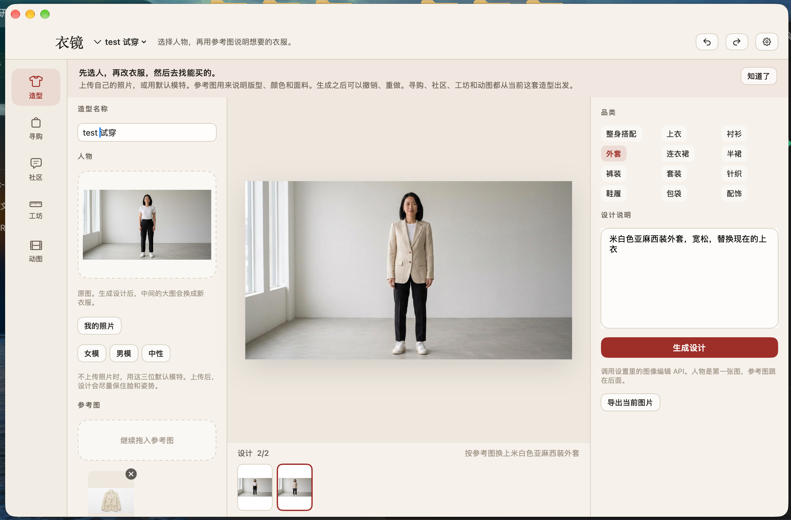
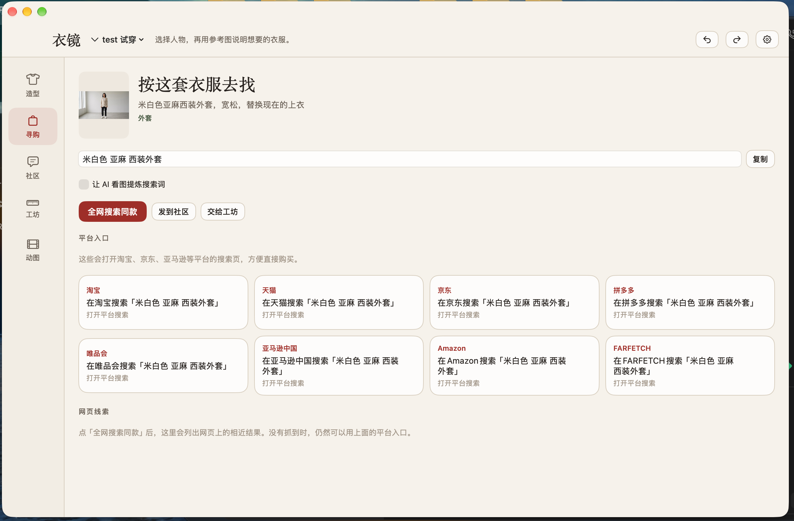
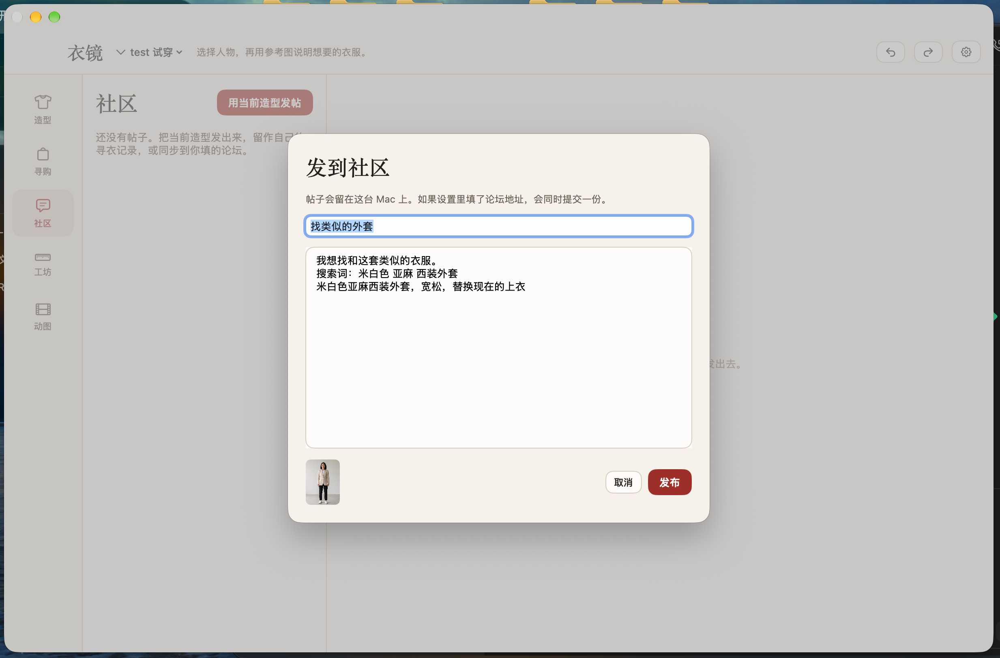
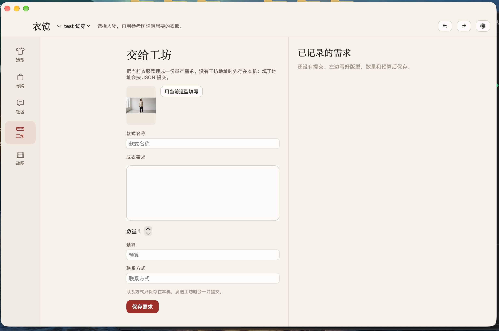
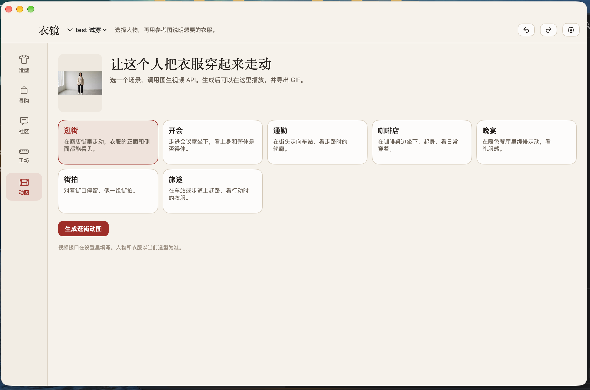

# 衣镜

衣镜是一个 macOS 服装设计工具。可以上传自己的照片，也可以用软件里的默认模特。放入参考图并写明想要的衣服后，由图像模型改衣服。设计可以撤销和重做。之后可以按这套衣服去淘宝、京东、亚马逊等平台搜索，发到社区，交给工坊做量产，或生成逛街、开会等场景的动图。

图像编辑使用阿里云百炼上的千问图像编辑模型，动图使用万相图生视频模型。

## 编译

需要 macOS 14 和 Xcode 命令行工具。在本目录执行：

```bash
bash build.sh
```

完成后，上一级目录会出现 `衣镜.app`。

## 造型

左边放人物和参考图，右边写品类和设计说明。点「生成设计」后，中间的大图换成新衣服。下面的胶片可以回到某一步，窗口右上角可以撤销和重做。



千问图像编辑一次最多接收 3 张图，所以这里最多再放 2 张参考图。人物是第一张。

## 寻购

按当前衣服整理搜索词，并打开淘宝、天猫、京东、拼多多、唯品会、亚马逊中国、Amazon 和 FARFETCH 的搜索页。也可以抓取公开网页上的线索。



打开「让 AI 看图提炼搜索词」后，会用通义千问多模态模型根据当前图片写搜索词。

## 社区

可以把当前造型发成帖子，附上图片和搜索词。帖子保存在这台 Mac 上。设置里如果填了论坛地址，发布时会再提交一份 JSON。



## 工坊

把款式、数量、预算和联系方式整理成一份量产需求。没有工坊地址时只存在本机。填了地址后，按 JSON 提交，图片放在 `image_base64`。



联系方式只保存在本机；发送工坊时会一并提交。

## 动图

选择逛街、开会、通勤、咖啡店、晚宴、街拍或旅途。万相根据当前人物和衣服生成视频，可以在软件里播放，也可以导出 GIF。



## 接口

右上角齿轮打开设置。第一次使用前，到[阿里云百炼](https://bailian.console.aliyun.com/)创建 API Key，再贴到图像和视频的密钥栏。两个接口可以用同一把 Key。也可以点「千问图像」和「万相视频」填入北京地域的默认地址。

图像编辑：

- 地址：`POST https://dashscope.aliyuncs.com/api/v1/services/aigc/multimodal-generation/generation`
- 模型：`qwen-image-2.0-pro`
- 鉴权：`Authorization: Bearer <API Key>`
- 文档：[千问图像编辑](https://help.aliyun.com/zh/model-studio/qwen-image-edit-api)

图生视频：

- 创建：`POST https://dashscope.aliyuncs.com/api/v1/services/aigc/video-generation/video-synthesis`
- 请求头：`X-DashScope-Async: enable`
- 模型：`wan2.6-i2v-flash`
- 查询：`GET https://dashscope.aliyuncs.com/api/v1/tasks/{task_id}`
- 文档：[万相图生视频](https://help.aliyun.com/zh/model-studio/image-to-video-guide)

如果使用业务空间域名，把基址换成 `https://{WorkspaceId}.cn-beijing.maas.aliyuncs.com/api/v1`。新加坡地域使用 `https://dashscope-intl.aliyuncs.com/api/v1`，并换成该地域的 API Key。北京和新加坡的 Key 不能混用。

看图写搜索词走兼容接口 `https://dashscope.aliyuncs.com/compatible-mode/v1/chat/completions`，模型是 `qwen-vl-plus`。密钥留空时，沿用图像接口的密钥。

密钥写在 `~/Library/Application Support/衣镜/settings.json`，权限限于当前用户。造型、图片和视频在同目录的 `library.json` 和 `media` 里。

## 商业模式

C 端按次收费：用户每执行一次设计或动图，就收取一次费用。

B 端对接会员：接入淘宝 88VIP、京东 PLUS 等会员能力，让会员在对应平台里完成设计和购买。

## 许可

禁止未经许可将本项目用于商业用途。如需商用，请联系 chenyangwu@mail.nankai.edu.cn。
